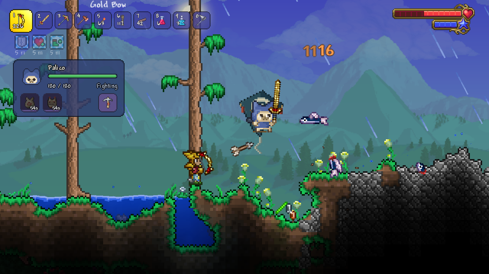
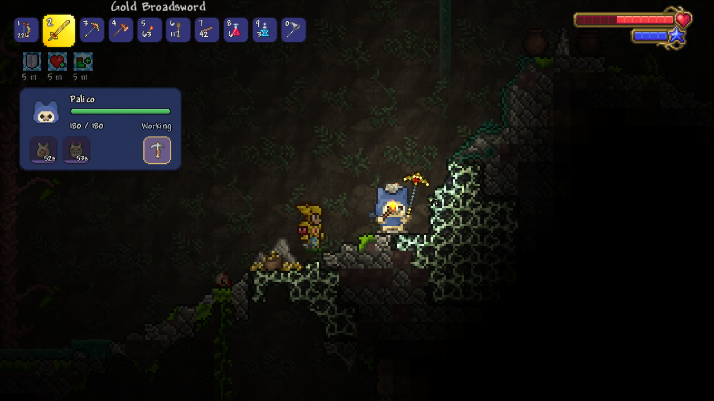
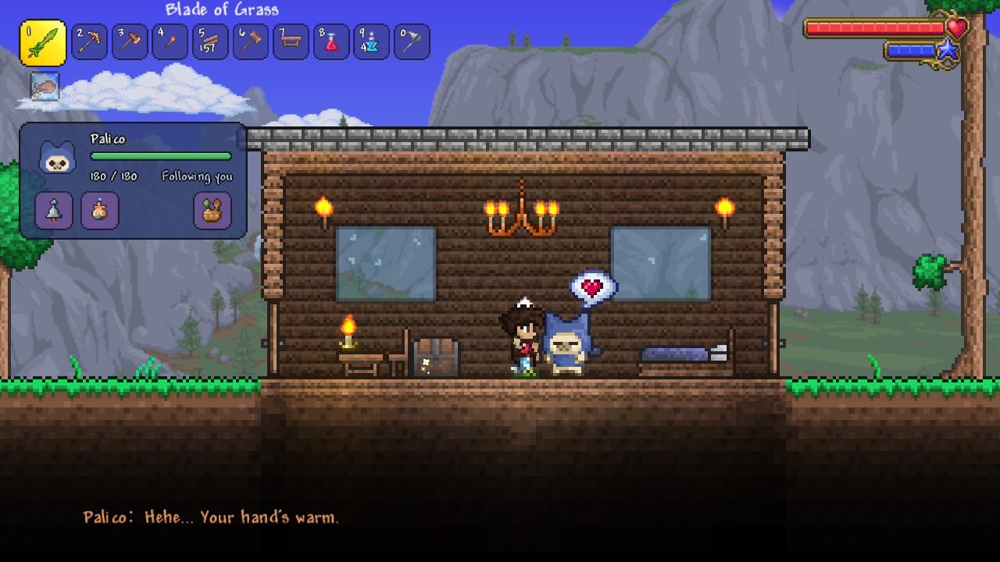
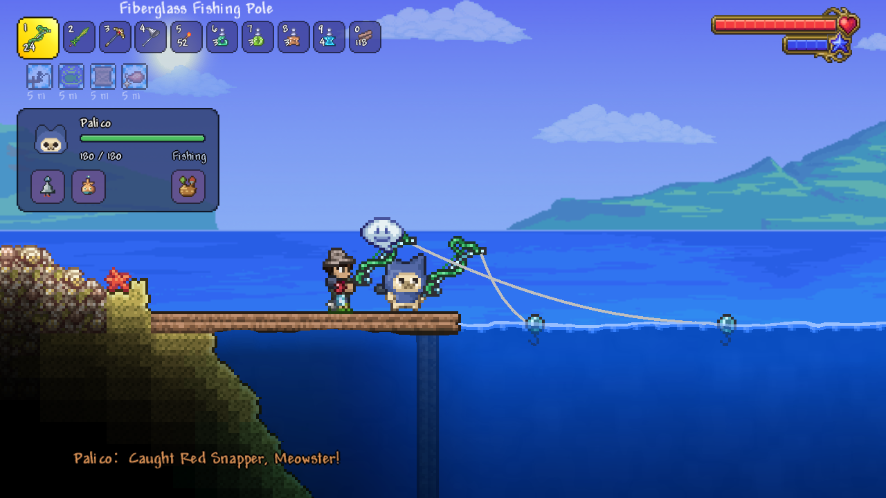

<h1 align="center">Palico Companion</h1>

A tModLoader companion mod inspired by Monster Hunter's Felynes.

<a href="https://steamcommunity.com/sharedfiles/filedetails/?id=3824240391">Steam Workshop</a> · <a href="https://youtu.be/9R5gHG-Hgbc">Watch on YouTube</a> · <a href="README.md">简体中文</a> · <a href="https://github.com/lbnandy/palico-companion/issues">Report an issue</a>

## Adventure together

- **Combat and support.** Give your Palico a weapon and fight side by side. Equip the mod's new support gear for extra help in combat. When you're hurt, it can bring you nearby Hearts, too.
- **Gathering and exploring.** Your Palico can mine ore, chop and replant trees, tend herbs, fish, catch critters and collect items. It can also light up dark areas and point out nearby chests and Life Crystals.
- **Your own Palico.** Choose a name, outfit color and dye. Your Palico chats with you and reacts with emotes. You can pet it, too.

  
  
   
  
  

## Equipment and inventory

Equip your Palico and save multiple loadouts to switch between.

Your Palico has its own backpack for supplies and loot. Give it access to selected chests, and it can put items away alongside others of the same type and restock its supplies.

## Installation and first steps

Subscribe on the [Steam Workshop](https://steamcommunity.com/sharedfiles/filedetails/?id=3824240391), enable the mod and enter a world to meet your Palico. Requires **tModLoader 1.4.4**. Supports English, Simplified Chinese, single-player and multiplayer, including existing characters and worlds.

By default, `P` opens the panel, `K` recalls your Palico, and holding `V` while left-clicking assigns a work target. Rebind these in the game's control settings.

Gather materials to craft and upgrade your Palico’s gear. The in-game Palico Guide explains how to craft, use and upgrade equipment.

## Customize your Palico’s abilities

The **Companion abilities** settings offer three strength presets: choose **Support** if you want to take the lead in combat, **Standard** to fight side by side, or **Strong** if you want to take it easy and let your Palico carry you. Standard is the default.

You can also fine-tune your Palico’s damage, health, defense, movement speeds in and out of combat, ability to dodge attacks, work speed and fishing speed individually.

In multiplayer, the host or server administrator manages these settings for every Palico on the server.

## Optional integrations

None of these mods are required:

- [Magic Storage](https://steamcommunity.com/sharedfiles/filedetails/?id=2563309347): let your Palico use your storage to put items away and restock its supplies.
- [Quality of Terraria](https://steamcommunity.com/sharedfiles/filedetails/?id=2797518634): your Palico follows its rules for unlimited ammo and other consumable items.
- [Calamity](https://steamcommunity.com/sharedfiles/filedetails/?id=2824688072): your Palico has dialogue for its biomes and bosses, and can use some of its special weapon mechanics.

See [compatibility notes](docs/COMPATIBILITY.md#english) for weapon support and known limits.

## Feedback and development

When [reporting a bug](https://github.com/lbnandy/palico-companion/issues), please include your game and mod versions, which other mods you're using, whether you're playing solo or in multiplayer, and how to reproduce the problem. For weapon problems, include the weapon's name. A screenshot helps with visual issues.

[Building and development](docs/DEVELOPMENT.md#english) · [Contributing](CONTRIBUTING.md#english) · [Changelog](CHANGELOG.md) · [Third-party licenses](ThirdParty/README.md)

Created by [LBN](https://github.com/lbnandy). Licensed under the [MIT License](LICENSE).
