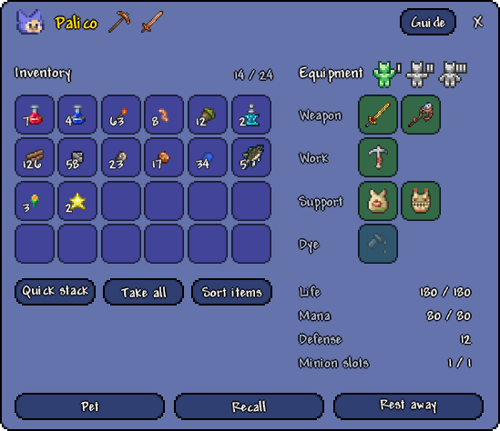

<h1 align="center">Palico Companion</h1>

A tModLoader companion mod inspired by Monster Hunter's Felynes.

<a href="https://steamcommunity.com/sharedfiles/filedetails/?id=3824240391">Steam Workshop</a> · <a href="README.md">简体中文</a> · <a href="https://github.com/lbnandy/palico-companion/issues">Report an issue</a>

## Adventure together

- **Combat and support.** Give your Palico a weapon and fight side by side. Support gear can heal, shield, clear debuffs, throw pot bombs or send your Palico charging into a group with a Giga Barrel Bomb. When you're hurt, it can bring you nearby Hearts, too.
- **Gathering and exploring.** Your Palico can mine ore, chop and replant trees, tend herbs, fish, catch critters and collect items. It can also light up dark areas and point out nearby chests and Life Crystals.
- **Your own Palico.** Choose a name, outfit color and dye. Your Palico chats with you and reacts with emotes. You can pet it, feed it or fly it as a kite, too.

## Equipment and inventory

Equip your Palico and save multiple loadouts to switch between.

Unused main weapons are carried on the back or waist and move with your Palico. You can turn this off in the appearance settings.

Your Palico has its own backpack for supplies and loot. Favorited items remain usable and stay in its backpack when you retrieve everything else. Give it access to selected chests, and it can put items away alongside others of the same type and restock its supplies.

## Installation and first steps

Subscribe on the [Steam Workshop](https://steamcommunity.com/sharedfiles/filedetails/?id=3824240391), enable the mod and enter a world to meet your Palico. Requires **tModLoader 1.4.4**. Supports English, Simplified Chinese, single-player and multiplayer, including existing characters and worlds.

By default, `P` opens the panel, `K` recalls your Palico, and holding `V` while left-clicking assigns a work target. Rebind these in the game's control settings.

You can also bind a key to stow or call out your Palico. The panel supports gamepad controls, and clicking its sword button cycles through proactive, assist and passive modes. Passive mode keeps work, pickup and healing available.

Gather materials to craft and upgrade your Palico’s gear. The in-game Palico Guide explains how to craft, use and upgrade equipment.

## Customize your Palico’s abilities

The **Companion abilities** settings offer three strength presets: choose **Support** if you want to take the lead in combat, **Standard** to fight side by side, or **Strong** if you want to take it easy and let your Palico carry you. Standard is the default.

You can also fine-tune your Palico’s damage, health, defense, inherited health regeneration, targeting range, movement speeds in and out of combat, ability to dodge attacks, work speed and fishing speed individually. Targeting range is adjustable from 50% to 150% (default 100%); it does not change the weapon's own reach and is unaffected by strength presets.

Your Palico inherits 50% of the owner's standard bonus health regeneration by default, adjustable from 0% to 100%. Set it to 0 to keep only the Palico's own regeneration. Recovery after damage uses its own timer, and strength presets leave this percentage unchanged.

An optional boss health bonus adds a little more challenge when fighting together. It is off by default.

In multiplayer, the host or server administrator manages these settings for every Palico on the server.

## Optional integrations

None of these mods are required:

- [Magic Storage](https://steamcommunity.com/sharedfiles/filedetails/?id=2563309347): let your Palico use your storage to put items away and restock its supplies.
- [Quality of Terraria](https://steamcommunity.com/sharedfiles/filedetails/?id=2797518634): your Palico follows its rules for unlimited ammo and other consumable items.
- [Calamity](https://steamcommunity.com/sharedfiles/filedetails/?id=2824688072): your Palico has dialogue for its biomes and bosses, and can use some of its special weapon mechanics.
- [Thorium](https://steamcommunity.com/sharedfiles/filedetails/?id=2909886416): class support for instruments, healing tools and throwing weapons, including separate inspiration, ally healing and throwing exhaustion, plus dialogue for bosses, exploration and support actions. See the compatibility notes below for special-input limits.

See [compatibility notes](docs/COMPATIBILITY.md#english) for weapon support and known limits.

Secrets of the Shadows (SOTS) blade trails and void weapons are also supported, using a separate void meter for the Palico.

## Feedback and development

When [reporting a bug](https://github.com/lbnandy/palico-companion/issues), please include your game and mod versions, which other mods you're using, whether you're playing solo or in multiplayer, and how to reproduce the problem. For weapon problems, include the weapon's name. A screenshot helps with visual issues.

[Building and development](docs/DEVELOPMENT.md#english) · [Contributing](CONTRIBUTING.md#english) · [Changelog](CHANGELOG.md) · [Third-party licenses](ThirdParty/README.md)

Created by [LBN](https://github.com/lbnandy). Code and text documentation use the [MIT License](LICENSE). Artwork is excluded from MIT; see the [artwork license](ART_LICENSE.txt). Third-party content retains its own licenses.
