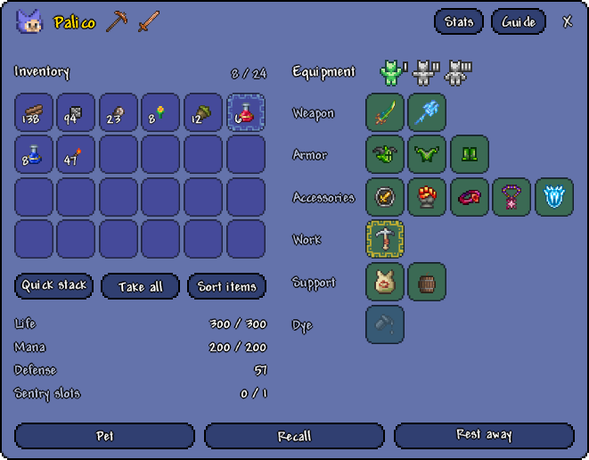
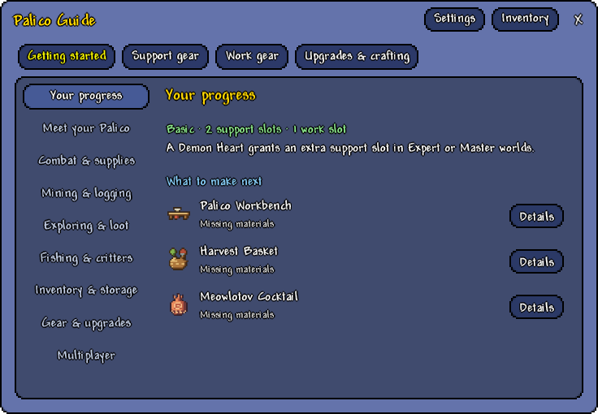

<h1 align="center">Palico Companion</h1>

A tModLoader companion mod inspired by Monster Hunter's Felynes.

<a href="https://steamcommunity.com/sharedfiles/filedetails/?id=3824240391">Steam Workshop</a> · <a href="README.md">简体中文</a> · <a href="https://github.com/lbnandy/palico-companion/issues">Report an issue</a>

## Adventure together

- **Combat and support.** Give your Palico a weapon and fight side by side. Support gear can heal, shield, clear debuffs, throw pot bombs or send your Palico charging into a group with a Giga Barrel Bomb. When you're hurt, it can bring you nearby Hearts, too.
- **Gathering and exploring.** Your Palico can mine ore, chop and replant trees, tend herbs, fish, catch critters and collect items. It can also light up dark areas and point out nearby chests and Life Crystals.
- **Your own Palico.** Choose a name, outfit color and dye. Your Palico chats with you and reacts with emotes. Dialogue appears overhead by default, with chat fallback when off-screen; you can also choose overhead only, chat only, or both. You can pet it, feed it or fly it as a kite, too.

## Equipment and inventory

Choose between two attribute modes:

- **Player-stat inheritance**: Use the owner's stats without preparing a separate set of armor and accessories.
- **Independent equipment**: Equip your Palico with its own armor and accessories to gain their stats and effects.

Switch modes in **Companion abilities**; equipped items are kept.

Save multiple loadouts and switch between them. Main weapons and summon weapons have separate slots; after summoning minions or deploying sentries, your Palico switches back to its main weapon. When switching loadouts, empty slots keep the matching favorited equipment.

Unused main weapons are carried on the back or waist and move with your Palico. You can turn this off in the appearance settings.

Your Palico has its own backpack for supplies and loot. Favorited items remain usable and stay in its backpack when you retrieve everything else. Give it access to selected chests, and it can put items away alongside others of the same type and restock its supplies.

## Installation and first steps

Subscribe on the [Steam Workshop](https://steamcommunity.com/sharedfiles/filedetails/?id=3824240391), enable the mod and enter a world to meet your Palico. Requires **tModLoader 1.4.4**. Supports English, Simplified Chinese, single-player and multiplayer, including existing characters and worlds.

By default, `P` opens the panel, `K` recalls your Palico, and holding `V` while left-clicking assigns a work target. Rebind these in the game's control settings.

You can also bind a key to stow or call out your Palico. The panel supports gamepad controls, and clicking its sword button cycles through proactive, assist and passive modes. Passive mode keeps work, pickup and healing available.

Craft and upgrade your Palico's work and support gear with collected materials. The in-game Palico Guide covers recipes, uses and upgrades.

## Customize your Palico’s abilities

Both attribute modes support three strength presets in **Companion abilities**: choose **Support** if you want to take the lead in combat, **Standard** to fight side by side, or **Strong** if you want to take it easy and let your Palico carry you. Standard is the default.

You can also adjust damage, survivability, targeting range, movement, dodging, work and fishing speeds individually. Targeting range does not change a weapon's own reach.

**Player-stat inheritance:** Your Palico inherits bonuses for its weapon's damage class, adjustable from 0% to 100%. Armor and accessory trigger effects are not copied. It also inherits 50% of the owner's standard bonus health regeneration by default; set this to 0 to keep only its own regeneration. Recovery after taking damage uses a separate timer.

**Independent equipment:** Defense, combat bonuses and equipment-based regeneration come from the Palico's own armor and accessories. Base life and mana still follow the owner's permanent upgrades.

Open **Stats** in the panel to see current values. See the [compatibility notes](docs/COMPATIBILITY.md#english) for inheritance rules and supported mod equipment.

An optional boss health bonus adds a little more challenge when fighting together. It is off by default.

In multiplayer, each player chooses their own attribute mode. The host or server administrator manages shared settings such as strength multipliers.

## Optional integrations

None of these mods are required:

- [Magic Storage](https://steamcommunity.com/sharedfiles/filedetails/?id=2563309347): let your Palico use your storage to put items away and restock its supplies.
- [Quality of Terraria](https://steamcommunity.com/sharedfiles/filedetails/?id=2797518634): your Palico follows its rules for unlimited ammo and other consumable items.
- [Calamity](https://steamcommunity.com/sharedfiles/filedetails/?id=2824688072): your Palico has dialogue for its biomes and bosses, and can use some of its special weapon mechanics.
- [Thorium](https://steamcommunity.com/sharedfiles/filedetails/?id=2909886416): supports instruments, healing tools and throwing weapons, with dialogue for Thorium content. Your Palico can provide empowerments and heal allies; you can also heal it with ally-healing weapons.
- Secrets of the Shadows (SOTS): supports blade trails and void weapons, using a separate void meter for the Palico.

See [compatibility notes](docs/COMPATIBILITY.md#english) for weapon support and known limits.

## Feedback and development

When [reporting a bug](https://github.com/lbnandy/palico-companion/issues), please include your game and mod versions, which other mods you're using, whether you're playing solo or in multiplayer, how to reproduce the problem, and the log from that session. For weapon problems, include the weapon's name. A screenshot helps with visual issues.

[Building and development](docs/DEVELOPMENT.md#english) · [Contributing](CONTRIBUTING.md#english) · [Changelog](CHANGELOG.md) · [Third-party licenses](ThirdParty/README.md)

Created by [LBN](https://github.com/lbnandy). Code and text documentation use the [MIT License](LICENSE). Artwork is excluded from MIT; see the [artwork license](ART_LICENSE.txt). Third-party content retains its own licenses.
