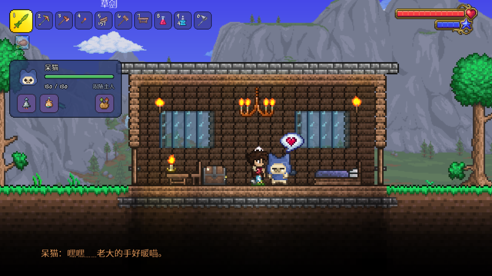
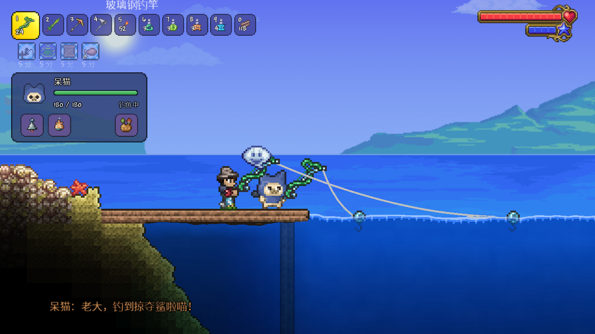

<h1 align="center">呆猫伙伴 · Palico Companion</h1>

一个以《怪物猎人》艾露猫为灵感的 tModLoader 伙伴模组。

<a href="https://steamcommunity.com/sharedfiles/filedetails/?id=3824240391">Steam 创意工坊</a> · <a href="https://www.bilibili.com/video/BV141np6YECi/">演示视频（B站）</a> · <a href="README.en.md">English</a> · <a href="https://github.com/lbnandy/palico-companion/issues">反馈问题</a>

## 一起冒险

- **战斗与支援**：给呆猫一把武器，它就会跟你一起战斗。搭配模组新增的支援装备，还能提供多种辅助效果。你受伤时，它也会把附近的红心送过来。
- **采集与探索**：挖矿、砍树补种、照料药草、钓鱼、抓小动物、捡东西，它都能搭把手。还会在暗处帮你照明，发现附近的宝箱、生命水晶也会提醒你。
- **你的呆猫**：给它起名字、换衣服颜色、搭配染料。它会跟你搭话，头顶也会冒出表情。闲下来可以摸摸它。

  
  
   
  
  

## 装备与背包

给呆猫搭配装备，也能保存多套配装，随时切换。

呆猫有自己的背包，能携带补给和战利品。你还可以允许它使用指定箱子，帮你存放同类物品、补充消耗品。

## 安装与上手

在 [Steam 创意工坊](https://steamcommunity.com/sharedfiles/filedetails/?id=3824240391)订阅并启用，进入世界即可遇到呆猫。适用于 **tModLoader 1.4.4**，支持简体中文、英文、单人和多人；已有角色与世界也能直接使用。

默认 `P` 打开面板、`K` 召回，按住 `V` 并左键指定工作目标。按键可在游戏控件设置中修改。

收集材料，为呆猫制作新装备，也能强化已有装备。装备怎么做、怎么用、还能怎样升级，都能在游戏内的「呆猫指南」里查到。

## 按你的喜好调整呆猫强度

想自己当主力，可以选**辅助**；想和呆猫并肩作战，可以选**标准**；想轻松些、让呆猫带飞，可以选**强力**。

默认使用标准档，也能在「呆猫强度」设置中单独调整呆猫的伤害、生命、防御、战斗移速、跟随与工作移速和闪避能力。

联机时，强度设置由房主或服务器管理员统一配置，对服务器内的所有呆猫生效。

## 可选联动

这些模组都不是必需的：

- [魔法存储](https://steamcommunity.com/sharedfiles/filedetails/?id=2563309347)：允许呆猫使用后，它会帮你存东西、补充消耗品。
- [更好的体验](https://steamcommunity.com/sharedfiles/filedetails/?id=2797518634)：无限弹药等免消耗设置对呆猫也有效。
- [灾厄](https://steamcommunity.com/sharedfiles/filedetails/?id=2824688072)：呆猫在对应环境中、遇到 Boss 时有专门的台词，也支持部分武器的特殊用法。

武器兼容与已知限制见[兼容说明](docs/COMPATIBILITY.md)。

## 反馈与开发

遇到问题可以在 [Issues](https://github.com/lbnandy/palico-companion/issues) 说明游戏和模组的版本、装了哪些模组、是否联机，以及怎样重现问题。武器问题请写出武器名称，画面问题最好附上截图。

[构建与开发](docs/DEVELOPMENT.md) · [参与修改](CONTRIBUTING.md) · [更新记录](CHANGELOG.md) · [第三方许可](ThirdParty/README.md)

作者：[LBN](https://github.com/lbnandy)。采用 [MIT 许可证](LICENSE)。
