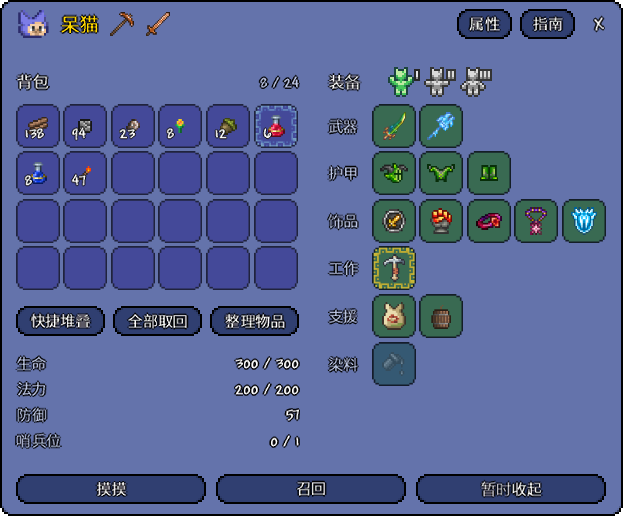
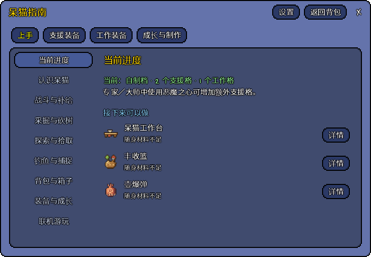

<h1 align="center">呆猫伙伴 · Palico Companion</h1>

一个以《怪物猎人》艾露猫为灵感的 tModLoader 伙伴模组。

<a href="https://steamcommunity.com/sharedfiles/filedetails/?id=3824240391">Steam 创意工坊</a> · <a href="https://www.bilibili.com/video/BV141np6YECi/">演示视频（B站）</a> · <a href="README.en.md">English</a> · <a href="https://github.com/lbnandy/palico-companion/issues">反馈问题</a>

## 一起冒险

- **战斗与支援**：给呆猫一把武器，它就会跟你一起战斗。搭配模组新增的支援装备，还能帮你回血、抵挡伤害、解除异常状态，投掷壶爆弹或扛起特大桶爆弹冲向怪群。你受伤时，它也会把附近的红心送过来。
- **采集与探索**：挖矿、砍树补种、照料药草、钓鱼、抓小动物、捡东西，它都能搭把手。还会在暗处帮你照明，发现附近的宝箱、生命水晶也会提醒你。
- **你的呆猫**：给它起名字、换衣服颜色、搭配染料。它会跟你搭话，头顶也会冒出表情。台词默认显示在头顶，离屏时补到聊天栏；也可选择仅头顶、仅聊天栏或两处显示。闲下来可以摸摸它、喂点吃的，还能把它当风筝放。

## 装备与背包

呆猫有两种属性模式：

- **继承玩家属性**：根据主人属性获得加成，不用另外准备护甲和饰品。
- **独立配装**：为呆猫搭配护甲和饰品，获得对应的属性与装备效果。

两种模式可在「呆猫能力」设置中切换，已装备的物品会保留。

可以保存多套配装，随时切换。主武器和召唤武器分栏装备，召出仆从或部署哨兵后，会切回主武器继续战斗。切换配装时，如果对应栏位为空，会沿用已收藏的装备。

未使用的主武器会背在身后或挂在腰间，随动作移动；可在外观设置中关闭。

呆猫有自己的背包，能携带补给和战利品。收藏的物品可以照常使用，一键取回时会留在呆猫背包里。你还可以允许它使用指定箱子，帮你存放同类物品、补充消耗品。

## 安装与上手

在 [Steam 创意工坊](https://steamcommunity.com/sharedfiles/filedetails/?id=3824240391)订阅并启用，进入世界即可遇到呆猫。适用于 **tModLoader 1.4.4**，支持简体中文、英文、单人和多人；已有角色与世界也能直接使用。

默认 `P` 打开面板、`K` 召回，按住 `V` 并左键指定工作目标。按键可在游戏控件设置中修改。

收回／叫出呆猫可单独绑定快捷键；面板支持手柄操作。连续点击面板里的剑形按钮，可依次切换主动进攻、协同进攻和不攻击。不攻击时仍可工作、拾取和治疗。

收集材料，制作和强化呆猫的工作与支援装备。具体配方、用途和升级方式，都能在游戏内的「呆猫指南」里查到。

## 按你的喜好调整呆猫能力

两种属性模式下，都可以在「呆猫能力」设置中选择三档强度预设：想自己当主力，可以选**辅助**；想和呆猫并肩作战，可以选**标准**；想轻松些、让呆猫带飞，可以选**强力**。默认使用标准档。

也能单独调整伤害、生存能力、索敌范围、移速、闪避、工作与钓鱼速度。索敌范围不改变武器本身的射程。

**继承玩家属性**：按呆猫武器对应的职业继承主人加成，可调为 0%～100%；不复制护甲、饰品的特殊触发效果。回血默认继承主人通用附加回血的 50%，设为 0 时只保留呆猫自身回血；受伤后的恢复计时独立计算。

**独立配装**：防御、战斗加成与装备回血来自呆猫自己的护甲和饰品。基础生命和魔力仍随主人的永久提升成长。

面板中的「属性」可查看当前数值，具体继承规则与模组装备支持范围见[兼容说明](docs/COMPATIBILITY.md)。

还可以开启 Boss 生命增强，为并肩作战增加一些挑战；默认关闭。

联机时，每位玩家可单独选择呆猫的属性模式；强度倍率等能力设置由房主或服务器管理员统一配置。

## 可选联动

这些模组都不是必需的：

- [魔法存储](https://steamcommunity.com/sharedfiles/filedetails/?id=2563309347)：允许呆猫使用后，它会帮你存东西、补充消耗品。
- [更好的体验](https://steamcommunity.com/sharedfiles/filedetails/?id=2797518634)：无限弹药等免消耗设置对呆猫也有效。
- [灾厄](https://steamcommunity.com/sharedfiles/filedetails/?id=2824688072)：呆猫在对应环境中、遇到 Boss 时有专门的台词，也支持部分武器的特殊用法。
- [瑟银](https://steamcommunity.com/sharedfiles/filedetails/?id=2909886416)：支持乐器、治疗工具与投掷武器，还有相关情景台词。呆猫可以演奏增益、治疗友军，你也可以用能治疗队友的武器给它回血。
- 暗影奥秘（SOTS）：支持刀光与虚空武器，呆猫使用独立的虚空值。

武器兼容与已知限制见[兼容说明](docs/COMPATIBILITY.md)。

## 反馈与开发

遇到问题可以在 [Issues](https://github.com/lbnandy/palico-companion/issues) 说明游戏和模组的版本、装了哪些模组、是否联机，以及复现步骤和当次游戏日志。武器问题请写出武器名称，画面问题可附截图。

[构建与开发](docs/DEVELOPMENT.md) · [参与修改](CONTRIBUTING.md) · [更新记录](CHANGELOG.md) · [第三方许可](ThirdParty/README.md)

作者：[LBN](https://github.com/lbnandy)。代码及文字文档采用 [MIT 许可证](LICENSE)；美术素材不适用 MIT，见[美术素材许可](ART_LICENSE.txt)。第三方内容遵循各自许可。

## 玩家交流

「呆猫伙伴」QQ 交流群：**974761337**。欢迎交流玩法、提建议，也可以在群里发送日志反馈问题。
