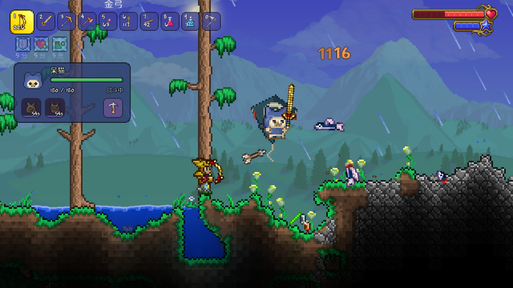
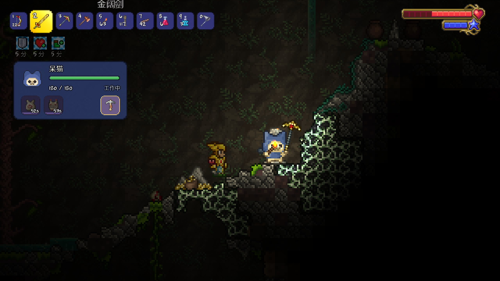

<h1 align="center">呆猫伙伴 · Palico Companion</h1>

带上你的呆猫，一起去泰拉瑞亚冒险。

<a href="https://steamcommunity.com/sharedfiles/filedetails/?id=3824240391">Steam 创意工坊</a> · <a href="README.en.md">English</a> · <a href="https://github.com/lbnandy/palico-companion/issues">反馈问题</a>

一个以《怪物猎人》艾露猫为灵感的 tModLoader 模组。给呆猫一把武器，它会跟你一起打怪；带它下矿，它会挖矿、举火把、捡东西。闲下来还能摸摸它，听它念叨两句。

## 一起冒险

- **战斗与支援**：使用你交给它的武器，搭配蜜虫笼、小盾牌等装备，帮你回血、挡伤害。
- **采集与探索**：挖矿、砍树补种、照料药草、钓鱼、拾取物品，发现附近的宝箱和生命水晶也会提醒你。
- **装备与背包**：保存不同配装，携带补给和战利品。允许它使用指定箱子后，还能存放同类物品、补充消耗品。
- **你的呆猫**：起名字、换衣服颜色、搭配染料。它会对遇到的怪物和事件作出反应，也会记住一起打赢的战斗。

## 安装与上手

在 [Steam 创意工坊](https://steamcommunity.com/sharedfiles/filedetails/?id=3824240391)订阅并启用，进入世界即可遇到呆猫。适用于 **tModLoader 1.4.4**，支持简体中文、英文、单人和多人；已有角色与世界也能直接使用。

默认 `P` 打开面板、`K` 召回，按住 `V` 并左键指定工作目标。按键可在游戏控件设置中修改，自动工作、拾取偏好和台词可在模组配置中调整。

游戏内的「呆猫指南」可以查装备效果、合成配方和工作指令，也会显示当前升级进度及接下来能制作的装备。

## 可选联动

这些模组都不是必需的：

- [魔法存储](https://steamcommunity.com/sharedfiles/filedetails/?id=2563309347)：允许呆猫使用后，它会帮你存东西、补充消耗品。
- [更好的体验](https://steamcommunity.com/sharedfiles/filedetails/?id=2797518634)：无限弹药等免消耗设置对呆猫也有效。
- [灾厄](https://steamcommunity.com/sharedfiles/filedetails/?id=2824688072)：呆猫在对应环境中、遇到 Boss 时有专门的台词，也支持部分武器的特殊用法。

武器兼容与已知限制见[兼容说明](docs/COMPATIBILITY.md)。

## 反馈与开发

遇到问题可以在 [Issues](https://github.com/lbnandy/palico-companion/issues) 说明游戏和模组的版本、装了哪些模组、是否联机，以及怎样重现问题。武器问题请写出武器名称，画面问题最好附上截图。

[构建与开发](docs/DEVELOPMENT.md) · [参与修改](CONTRIBUTING.md) · [更新记录](CHANGELOG.md) · [第三方许可](ThirdParty/README.md)

作者：[LBN](https://github.com/lbnandy)。采用 [MIT 许可证](LICENSE)。
